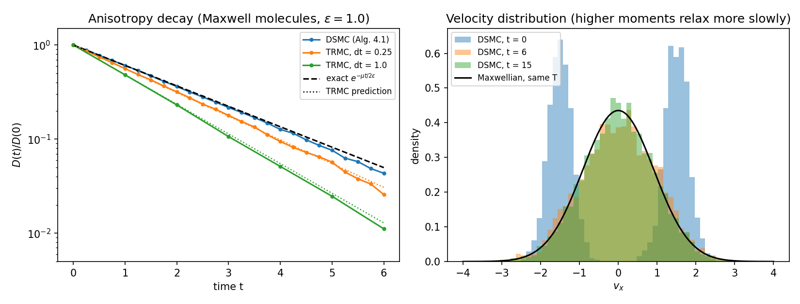
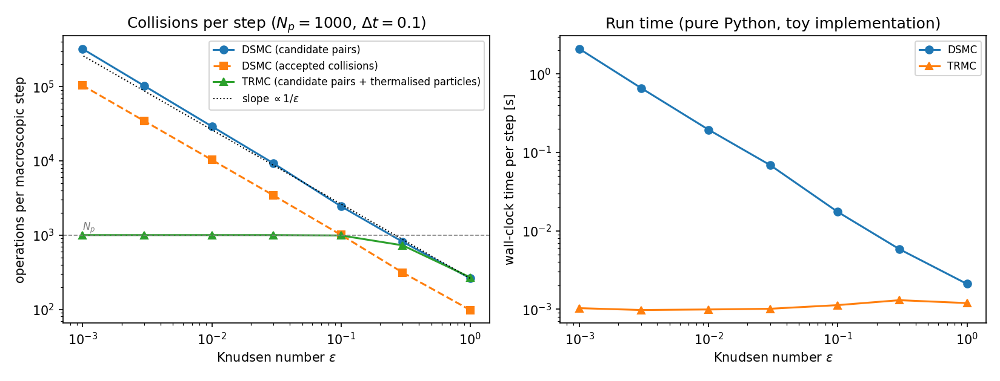

# Monte Carlo Methods for the Boltzmann Equation: from DSMC to Time Relaxed Schemes

A pedagogical report and a small, tested Python implementation of particle methods for the **Boltzmann equation**: Bird's **Direct Simulation Monte Carlo (DSMC)** and the first-order **Time Relaxed Monte Carlo (TRMC)** scheme of Pareschi and Russo.

The report was written for the course *Methods and Models for Statistical Mechanics* (Politecnico di Milano, A.Y. 2025/2026, advisor Prof. Silvia Lorenzani). It follows the structure of Pareschi and Russo's *An Introduction to Monte Carlo Method for the Boltzmann Equation* and adds derivations and explanations meant to make the subject accessible to newcomers. The code turns the algorithms of the report into running programs and checks them against exact results.


## The report

📄 **[Read the report (PDF)](report/ReportDsmcTRMC.pdf)**

It is self-contained and goes from the physics to the algorithms:

1. **The Boltzmann equation**: collision operator, VHS model, boundary conditions, fluid-dynamic limit, operator splitting.
2. **Monte Carlo fundamentals**: law of large numbers, statistical error, importance sampling, sampling techniques, particle methods.
3. **DSMC and TRMC**: Bird's schemes for Maxwell and VHS molecules, the Wild sum, first-order, higher-order and recursive TRMC, the space-inhomogeneous case and boundary conditions.
4. **Appendix A**: heuristic derivation of the Boltzmann equation from N hard spheres (Boltzmann-Grad limit, molecular chaos).
5. **Appendix B**: the sampling algorithms used throughout.

## The code

A toy implementation of the **space-homogeneous** collision step, written for clarity rather than speed (pure Python and NumPy).

| Report | Code |
|---|---|
| Eq. (2.4), post-collisional velocities | `collisions.post_collision` |
| Eq. (4.9), VHS cross section | `collisions.VHS` |
| Algorithm 4.1, Bird's scheme for Maxwell molecules | `DSMC._advance_maxwell` in `dsmc.py` |
| Algorithm 4.2, Bird's scheme for VHS molecules (majorant, acceptance-rejection, clock) | `DSMC._advance_vhs` in `dsmc.py` |
| Algorithm 4.3, first-order TRMC | `TRMC.advance` in `trmc.py` |
| Pullin's conservative Maxwellian sampling | `trmc.pullin_maxwellian` |
| Eq. (B.3), Box-Muller | `sampling.box_muller` |
| Eq. (B.4), uniform direction on S² | `sampling.uniform_sphere` |
| Algorithm B.6, sampling without repetition | `sampling.sample_without_repetition` |

**Not implemented (yet):** higher-order and recursive TRMC (Algorithms 4.4-4.5), and the space-inhomogeneous splitting with boundary conditions (Section 4.3, Algorithms 4.6-4.8).

### Quick start

```bash
git clone https://github.com/TomFogarin/boltzmann-dsmc-trmc.git
cd boltzmann-dsmc-trmc
pip install -r requirements.txt

python tests/test_core.py                    # 11 sanity tests
python examples/01_relaxation_maxwell.py     # figure + validation table
python examples/02_cost_vs_knudsen.py        # figure + cost table
```

Each example takes a few seconds and writes its figure to `docs/`.

```python
import numpy as np
from boltzmann_mc import DSMC, TRMC, VHS, sample_maxwellian, diagnostics

rng = np.random.default_rng(0)
v0 = sample_maxwellian(rng, 2000, T=1.0)             # initial velocities
gas = VHS(alpha=1.0)                                 # hard spheres (alpha=0: Maxwell)

dsmc = DSMC(v0, gas, eps=0.1, rng=rng)               # Bird's scheme
trmc = TRMC(v0, gas, eps=0.1, rng=rng)               # time relaxed scheme
dsmc.advance(0.1)
trmc.advance(0.1)
print(diagnostics.moments(dsmc.v), dsmc.stats)
```

## Results

### 1. DSMC reproduces the exact relaxation rate

Two counter-propagating beams relax to equilibrium under Maxwell molecules (ε = 1). For this model the anisotropy of the velocity distribution decays exactly as exp(−μt / 2ε), which gives a quantitative test of Algorithm 4.1.



Anisotropy D(t)/D(0), averaged over 8 runs with N<sub>p</sub> = 4000:

| t | exact | DSMC | TRMC, Δt = 0.25 | TRMC, Δt = 1.0 |
|---|---|---|---|---|
| 1 | 0.607 | 0.607 | 0.561 | 0.482 |
| 2 | 0.368 | 0.362 | 0.318 | 0.231 |
| 3 | 0.223 | 0.217 | 0.178 | 0.106 |
| 4 | 0.135 | 0.127 | 0.094 | 0.051 |

- DSMC follows the exact decay within statistical noise.
- First-order TRMC relaxes faster than the exact solution. This is the truncation error of the scheme, and it can be computed: one step multiplies the anisotropy by (1 − τ)(1 + τ/2), with τ = 1 − exp(−μΔt/ε), which agrees with the exact factor √(1 − τ) only to first order in τ. The dotted lines in the figure are this prediction, and they match the simulation.
- Mass, momentum and energy are conserved to machine precision in all runs (momentum drift below 10⁻¹², relative energy drift below 10⁻¹⁵).
- Higher moments relax more slowly than the anisotropy: the excess kurtosis of v<sub>x</sub> goes from −1.85 at t = 0 to −0.25 at t = 6 and about −0.06 at t = 15.

### 2. Why TRMC: cost as the Knudsen number goes to zero

Hard spheres, N<sub>p</sub> = 1000, one macroscopic step Δt = 0.1.



| ε | DSMC candidate pairs | TRMC pairs + thermalised particles |
|---|---|---|
| 1 | 262 | 270 |
| 0.1 | 2,441 | 989 |
| 0.01 | 29,130 | 1,000 |
| 0.001 | 321,821 | 1,000 |

The cost of DSMC grows like 1/ε because the mean collision time is proportional to ε. The cost of TRMC is bounded by N<sub>p</sub> for any ε: when μΔt/ε is large, a step simply resamples the whole ensemble from a Maxwellian with the exact momentum and energy of the ensemble (the *asymptotic preserving* property). In this toy implementation that is a speedup of about three orders of magnitude at ε = 10⁻³ (right panel of the figure, absolute times depend on your machine).

TRMC is not free: its accuracy is first order, as the table above shows, and in the fluid regime the result is a Maxwellian up to O(1/√N<sub>p</sub>) sampling noise.

## Tests

`tests/test_core.py` (runs with `pytest` or plain `python`) checks, among other things:

- conservation of momentum and energy in single collisions and in full DSMC and TRMC runs, in the kinetic and in the fluid regime;
- uniformity of the directions sampled on the sphere, Gaussian sampling, sampling without repetition;
- that Pullin's step reproduces the prescribed momentum and energy exactly;
- the exact Maxwell-molecule relaxation rate for DSMC;
- the asymptotic preserving behaviour of TRMC.

## Project structure

```
boltzmann-dsmc-trmc/
├── report/                  # the report (PDF)
├── boltzmann_mc/
│   ├── sampling.py          # Appendix B: Box-Muller, sphere, without repetition
│   ├── collisions.py        # VHS cross section, eq. (2.4)
│   ├── dsmc.py              # Algorithms 4.1 and 4.2
│   ├── trmc.py              # Algorithm 4.3 and Pullin's algorithm
│   └── diagnostics.py       # moments, anisotropy, kurtosis
├── examples/                # the two experiments above
├── tests/
├── docs/                    # figures
├── requirements.txt
└── LICENSE
```

## Roadmap

- Higher-order and recursive TRMC (Algorithms 4.4-4.5).
- Space-inhomogeneous problems in 1D: cells, operator splitting, periodic, reflecting and Maxwell walls, inflow (Section 4.3), for example a shock tube.
- Vectorised or Numba version for larger ensembles.

## References

- G. A. Bird, *Molecular Gas Dynamics and the Direct Simulation of Gas Flows*, Oxford University Press.
- L. Pareschi, G. Russo, *An introduction to Monte Carlo method for the Boltzmann equation*, ESAIM: Proceedings 10 (2002) 35-75.
- E. Wild, *On Boltzmann's equation in the kinetic theory of gases*, Math. Proc. Cambridge Philos. Soc. 47 (1951) 602-609.
- D. I. Pullin, *Generation of normal variates with given sample mean and variance*, J. Statist. Comput. Simul. 9 (1979) 303-309.

## Author

**Tommaso Fogarin**, M.Sc. student in Engineering Physics, Politecnico di Milano.
[LinkedIn](https://linkedin.com/in/tommasofogarin25) · Questions, feedback and ideas for discussion are welcome via GitHub issues.

## License

The code is released under the MIT License (see `LICENSE`). The report is shared for educational purposes; please cite it if you use it.
